# n8n Hospital Management Automation

An n8n capstone project demonstrating automated appointment booking, approval and rejection emails, medical-report text extraction and AI-assisted summarization, consultation reminders, and admin workflow logic.

> **Demo project:** Use synthetic patient data only. AI-generated medical-report summaries are for demonstration and must be reviewed by a qualified healthcare professional.

## 1. Appointment booking and approval

Patients submit their details through a form. The workflow checks existing records, routes the request for approval or rejection, updates records, and sends email notifications.

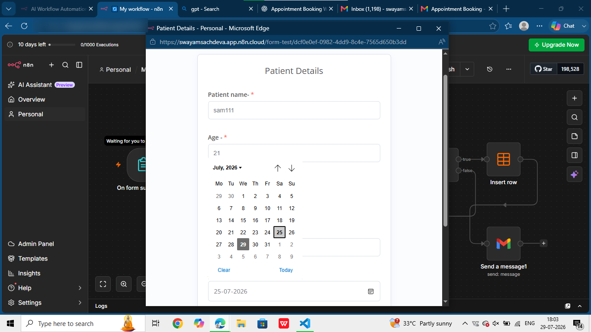

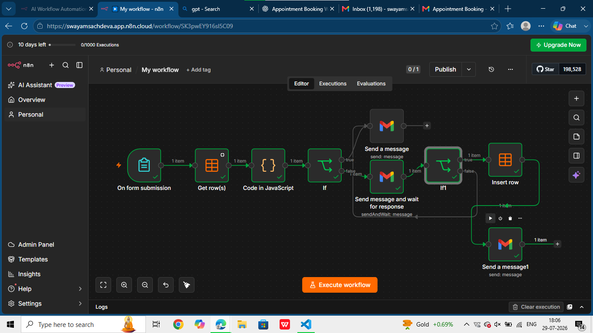

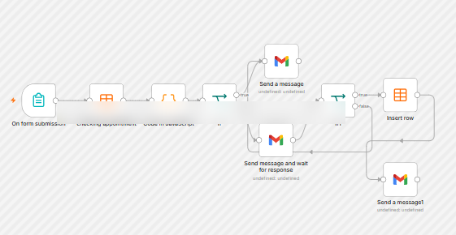

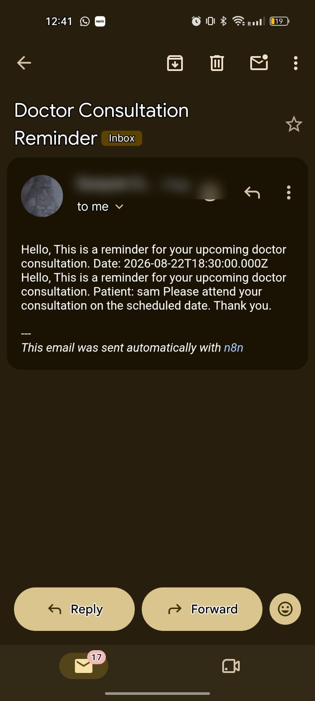

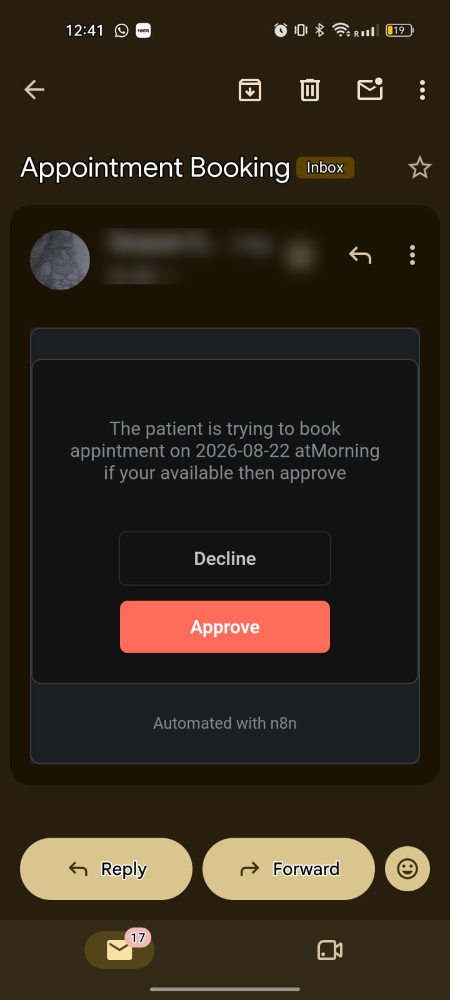

## 2. Medical report analysis

A Google Drive trigger starts the workflow. The file is downloaded, text is extracted through an OCR/API step, and an AI agent using a Google Gemini chat model prepares a summary that is emailed to the recipient.

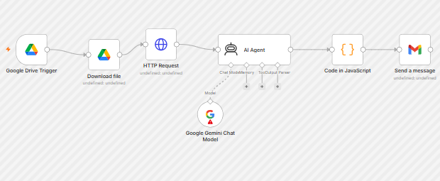

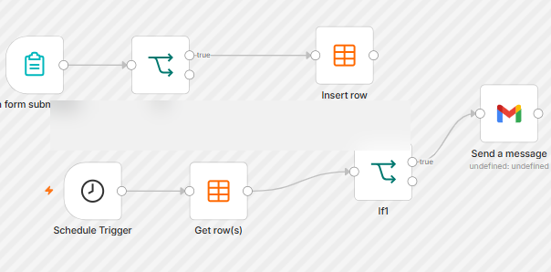

**Safety note:** OCR and AI can make mistakes. Do not upload real patient records or personal health information to a public repository.

## 3. Doctor consultation reminders

A scheduled workflow checks stored appointment records, applies condition logic, and sends reminder emails for upcoming consultations.

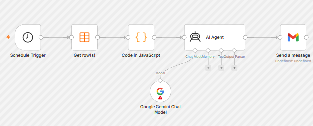

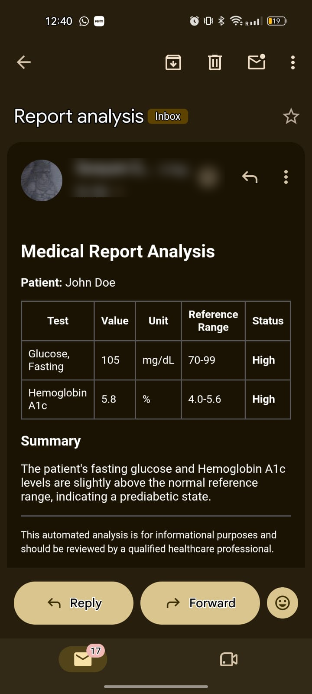

## 4. Admin workflow and execution

The admin-related workflow uses triggers, conditions, and data-table actions for record management and workflow routing.

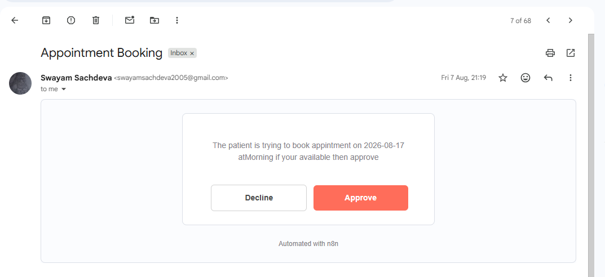

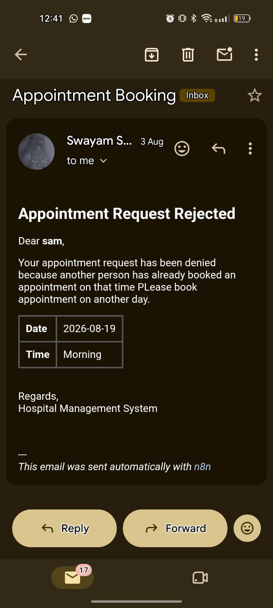

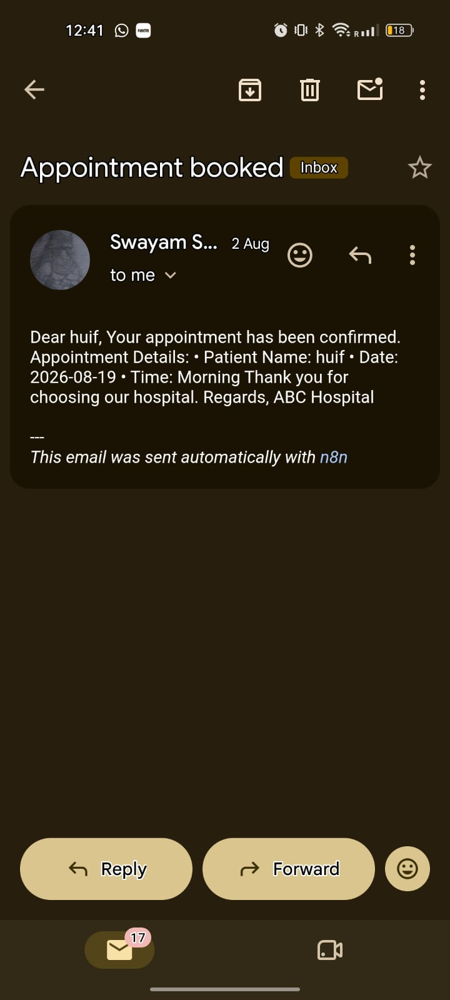

## Technologies and integrations

- **n8n** — workflow automation
- **Google Drive** — report file trigger and download
- **OCR/API integration** — extracting text from uploaded reports
- **Google Gemini** — AI-assisted report summarization
- **Gmail** — approval, status, report, and reminder emails
- **n8n Data Tables or configured data storage** — storing and checking workflow records

Adjust this list to match the integrations in your final workflow exports.

## Repository structure

```text
.
├── README.md
├── workflows/
│   ├── 01-appointment-booking.json
│   ├── 02-medical-report-analysis.json
│   ├── 03-consultation-reminders.json
│   └── 04-admin-management.json
├── screenshots/
│   ├── 01-appointment-form.png
│   ├── 02-appointment-booking-workflow.png
│   └── ...
└── docs/
    └── project-documentation.pdf
```

## Setup

1. Open your n8n instance.
2. Import the workflow JSON files.
3. Create your own credentials for Google, Gmail, Gemini, the OCR/API provider, and any other required services.
4. Check node parameters, form fields, table names, and data mappings.
5. Test each workflow using synthetic data before enabling production triggers.
6. Review the execution logs and confirm that records and email notifications work as expected.

## Security and limitations

- Never commit API keys, OAuth tokens, passwords, or credential exports.
- Inspect workflow JSON files for sensitive values before publishing.
- Use fake patient names and synthetic reports in screenshots.
- OCR and LLM outputs may be incomplete or incorrect; this project does not replace clinical review.

## Author

**Swayam Sachdeva**
